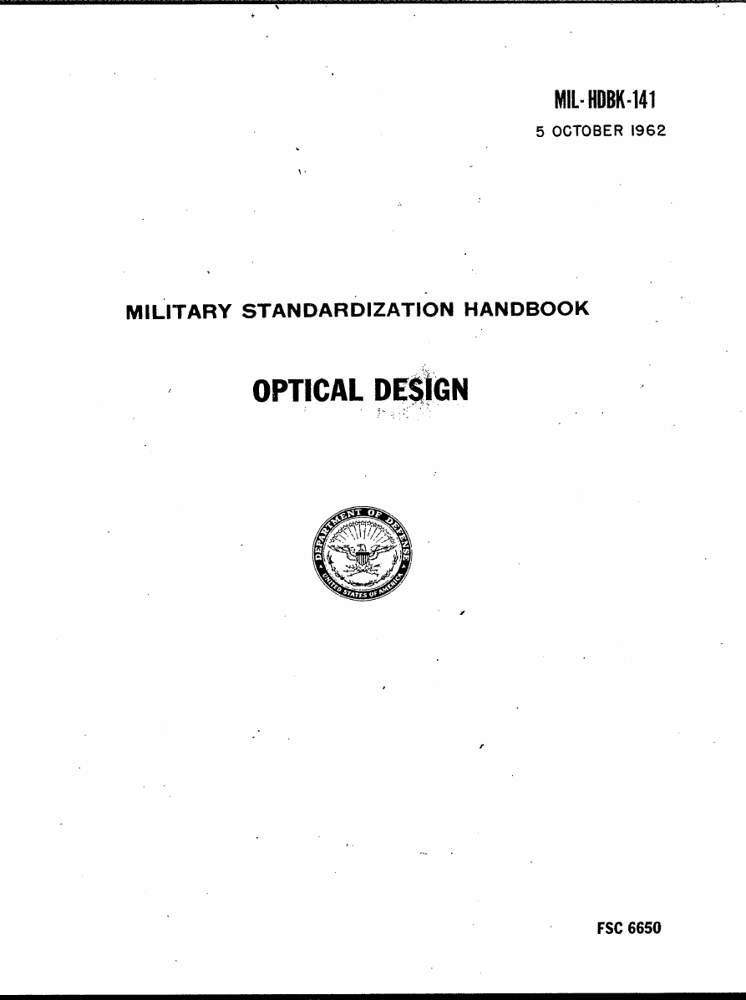

# MIL-HDBK-141: Modernized Edition

> [!NOTE]
> **Work in progress.** The text, equations and tables are complete; most figures are still being
> redrawn and appear as "TBD" boxes in the PDF. See [Status](#status).

<p align="center">
  <a href="https://github.com/jfblanchard/MIL-HDBK-141/blob/master/build/MIL-HDBK-141.pdf"><kbd></kbd></a>
</p>

A faithful, machine-readable modernization of **MIL-HDBK-141, "Optical Design" (1962)**, the
U.S. military's 500+ page optical design handbook and a standard reference for
optical engineers from the 1960s through the 1980s (in service until 1986,
and still circulated among designers today). This project
transcribes the full text into corrected, page-referenced Markdown, rebuilds
every display equation in LaTeX, and regenerates the figures with real optics
tooling (ray tracing and matplotlib), then
renders the whole work as a single searchable PDF.

**This is an unofficial derivative work.** It is a transcription, not an authoritative
copy. For anything safety-, contractual-, or regulatory-critical, verify against the
original scans in `docs/scans/`; those PDFs are the ground truth, always.

**Quick links:** [read the PDF](https://github.com/jfblanchard/MIL-HDBK-141/blob/master/build/MIL-HDBK-141.pdf) (opens in your browser) · [lost-gems catalog](https://github.com/jfblanchard/MIL-HDBK-141/blob/master/analysis/LOST_GEMS_CATALOG.md) · [original 1962 scans](https://github.com/jfblanchard/MIL-HDBK-141/tree/master/docs/scans)

## What's here

| Path | Contents |
|---|---|
| `docs/scans/` | Original 1962 scans, one PDF per chapter, the authoritative source |
| `ocr_output/` | Corrected per-chapter Markdown (ch00–ch28) |
| `build/` | LaTeX sources + rendered `MIL-HDBK-141.pdf` (~584 pp, 1,543 display equations) |
| `build/lens_designs/` | Per-figure OptiLand ray-tracing systems and matplotlib scripts |
| `analysis/` | `LOST_GEMS_CATALOG.md`: 6k-line index of every concept, equation, and table |
| `pipeline/` | OCR, cleanup, and table-reconciliation scripts |
| `verification/` | Equation-verification scripts, figure audit, QA reports |
| `exchanges/` | External-LLM validation audit trail (see below) |

## How this is validated

Trust in a transcription comes from layered, independent checks. Every chapter went
through all of these:

0. **OCR baseline.** Tesseract (psm 6) with OpenCV figure/table region detection
   (`pipeline/ocr_pipeline.py`) produces the layer-0 text and the `[FIGURE]`/`[TABLE]`
   placeholder inventory.
1. **VLM transcription pass.** A vision-language model (Claude) reads the scan pages
   directly and corrects the raw OCR, page by page; dense tables and equations are
   re-read from high-DPI crops.
2. **Blind external validation.** A *different* model (DeepSeek) reviews each chapter
   against the same rules, without seeing the first pass's reasoning. The validator's
   system prompt, every prompt sent, and every response received are in `exchanges/`
   as a public audit trail.
3. **Reconciliation.** Disagreements are resolved against the scan. Confirmed errors
   in the *1962 original* are kept as printed and flagged `(sic, as printed)`;
   this edition documents the book's errata rather than silently fixing them.
4. **Numeric equation verification.** Display equations are actually *computed*, not
   just read: `verification/eq_verify/` re-derives results. Ledger in
   `verification/EQUATION_VERIFICATION.md` (~1,013 verified, 7 corrected, 34 flagged,
   26 not independently verifiable).
5. **Figure audit & regeneration.** All 529 figure blocks were inventoried
   (`verification/FIGURE_AUDIT.md`); specs were drafted with Gemini flash-class VLMs.
   Figures are being rebuilt, not image-copied: schematics as true-scale OptiLand
   ray-traced constructions, data plots as matplotlib with measured curves traced
   from the scans. Per-figure status: `verification/OPTiLAND_BATCH_MANIFEST.md`.
6. **Render.** Pandoc + pdflatex (`build/build_pdf.py`) assembles the book PDF.
   Until a figure ships, its location prints as a framed "TBD" box carrying the
   figure number, book page, and extracted description, so the gap map is visible
   at a glance.

**Provenance / work record.** Per-chapter metadata (which model ran which pass,
on which date, against which baseline) is recorded at the head of each
`ocr_output/chNN.md` file and in the terminal notes appended to several chapters.
It is deliberately kept *out* of the printed book. The public audit trail lives in
`exchanges/` (every external-validation prompt and response) and `CHANGELOG.md`
(per-commit history).

**Known limitations.** This is a work in progress, transcription errors may
remain, and most of the figures are still TBD (the PDF prints their
locations as framed boxes). A handful need extra work because the book
doesn't print the optical prescriptions they require; none are guessed. Open
defects are tracked in the verification reports and changelog.

## The "gems": rules of thumb from the slide-rule era

MIL-HDBK-141 was written when a single lens ray trace meant an afternoon at a desk
calculator, so its real currency is heuristics: the short formulas and design
rules an experienced designer used to land near a good solution on the first
try. A few examples:

- **Start every triplet design with R = 1.**
- **Two-Ray Rule.** Two independent paraxial rays completely characterize
  first-order optics; any third ray is a linear combination of them.
- **Symmetric field lens.** Lateral color cancels by symmetry.

Scattered through 500+ pages of prose, these rules are easy to miss, so the
project pulls every one out into a catalog: the formula, the section it came
from, and a "use today" note on when the rule still earns its keep.

**[Browse the Lost Gems catalog →](https://github.com/jfblanchard/MIL-HDBK-141/blob/master/analysis/LOST_GEMS_CATALOG.md)**
(~6k lines: every concept, equation, and table worth extracting)

## Build

```bash
python3 build/build_pdf.py           # all chapters → build/MIL-HDBK-141.pdf
python3 build/build_pdf.py ch05 ch20 # or selected chapters
```

Requires pandoc, a TeX distribution (pdflatex), and Python 3. Figure regeneration
additionally uses OptiLand and matplotlib (see `build/lens_designs/`).

## Status

Full-corpus text capture is complete: OCR, validation, gems catalog, LaTeX
transcription, and PDF render are all done. Most figures are still TBD; their
locations print in the PDF as framed boxes while the redraws are made and
checked against the scans. See `CHANGELOG.md` for
per-commit history and the `verification/` reports for detail.

## License

The original 1962 handbook (including the scans in `docs/scans/`) is a U.S. Government
work and is in the public domain. Everything added here (transcriptions, corrections,
the gems catalog, figure rebuilds, and code) is MIT licensed; see [LICENSE](LICENSE).
